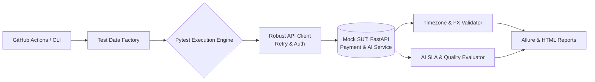

# Enterprise Omni-QA Automation Framework

[](https://github.com)


An enterprise-grade, cloud-native **Test Automation & Quality Engineering Framework** designed for distributed, multi-timezone, and AI-driven applications. Built with **Pytest, FastAPI, Locust, Docker, and GitHub Actions**.

---

## Architecture Overview



---

## Key Engineering Highlights

* **Cross-Timezone Daily Cutoff Verification (`core/timezone_helper.py`)**: Solves multi-region billing reconciliation discrepancies (e.g., validating boundary transactions between `Europe/Paris` UTC+1/+2 and `Asia/Shanghai` UTC+8).
* **Payment Idempotency & FX Precision (`testcases/api_payment/`)**: Verifies multi-currency settlement rounding (`EUR`, `USD`, `CNY`), localization headers (`fr-FR`, `en-US`, `zh-CN`), and `409 Conflict` idempotency guards against duplicate network retries.
* **AI Feature SLA & Resilience Evaluation (`core/ai_evaluator.py`)**: Validates latency thresholds, output integrity, and graceful degradation under simulated weak-network conditions for AIGC/style-transfer endpoints.
* **Zero-Dependency Test Data Factory (`utils/data_factory.py`)**: Eliminates shared test data flakiness by dynamically generating unique order payloads, UUID idempotency keys, and boundary timestamps on the fly.
* **Containerized & CI/CD Ready**: Includes a self-contained FastAPI System Under Test (`mock_server/`), `docker-compose` orchestration, `Locust` load testing scripts, and automated GitHub Actions regression workflows.

---

## Project Structure

```text
enterprise-omni-qa-framework/
├── .github/workflows/ci-regression.yml   # Automated CI pipeline & report artifact upload
├── config/                               # Environment & i18n test data configurations
├── core/                                 # Reusable engines (Retry API client, Timezone, AI Eval)
├── mock_server/app.py                    # Self-contained FastAPI SUT (Payment & AI endpoints)
├── performance/locust_payment_load.py    # Code-driven load & P99 latency test script
├── testcases/                            # Modular test suites (Payment, i18n, AI features)
├── utils/                                # Test Data Factory & structured logger
├── Dockerfile                            # Test runner container definition
└── docker-compose.yml                    # One-command SUT + Test Runner orchestration
```

---

## Quick Start

### Option 1: Run via Docker Compose (Recommended)
Run the mock backend and the entire automated test suite in isolated containers with a single command:
```bash
docker-compose up --build --abort-on-container-exit
```

### Option 2: Run Locally
```bash
# 1. Create and activate virtual environment
python3 -m venv venv
source venv/bin/activate

# 2. Install dependencies
pip install -r requirements.txt

# 3. Start the Mock SUT server in background
uvicorn mock_server.app:app --host 127.0.0.1 --port 8000 &

# 4. Execute full test suite with Allure & HTML reporting
PYTHONPATH=. pytest -v --html=report.html --self-contained-html --alluredir=./allure-results
```

### Option 3: Run Load Testing (Locust)
```bash
locust -f performance/locust_payment_load.py --host=http://127.0.0.1:8000
```
